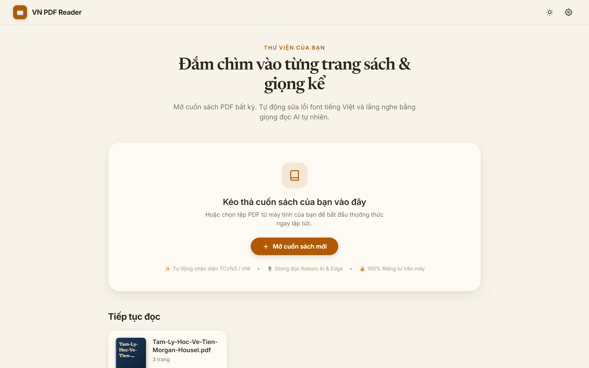
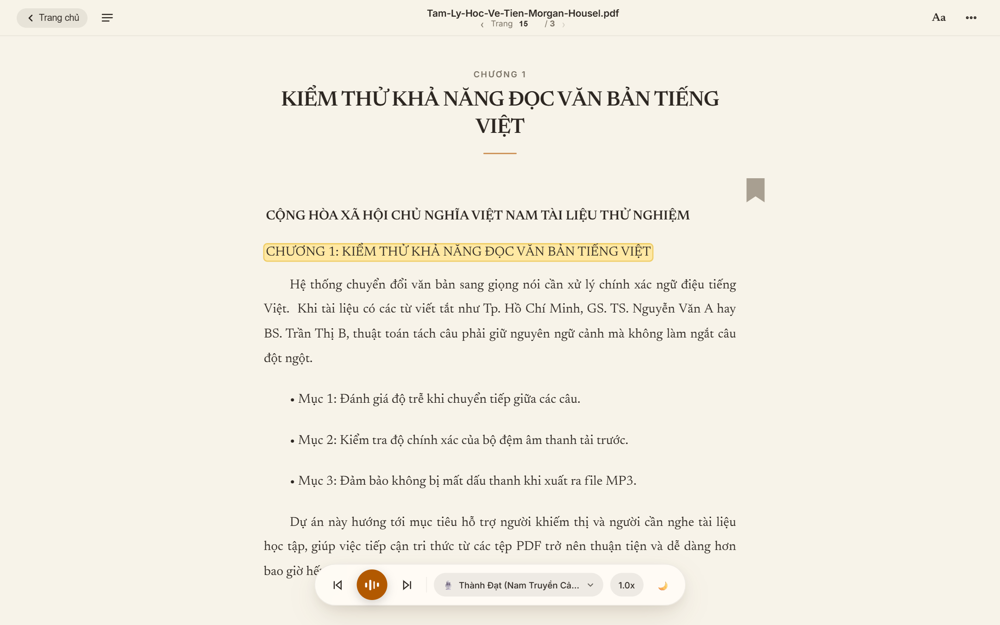
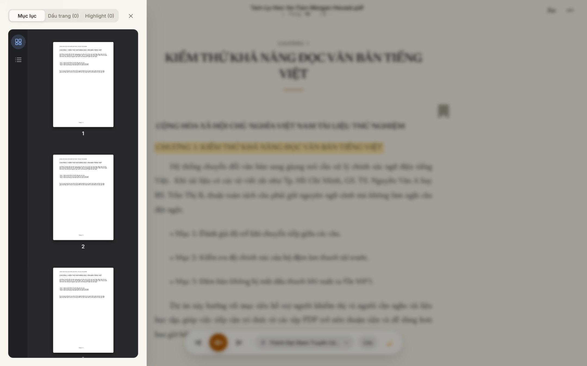
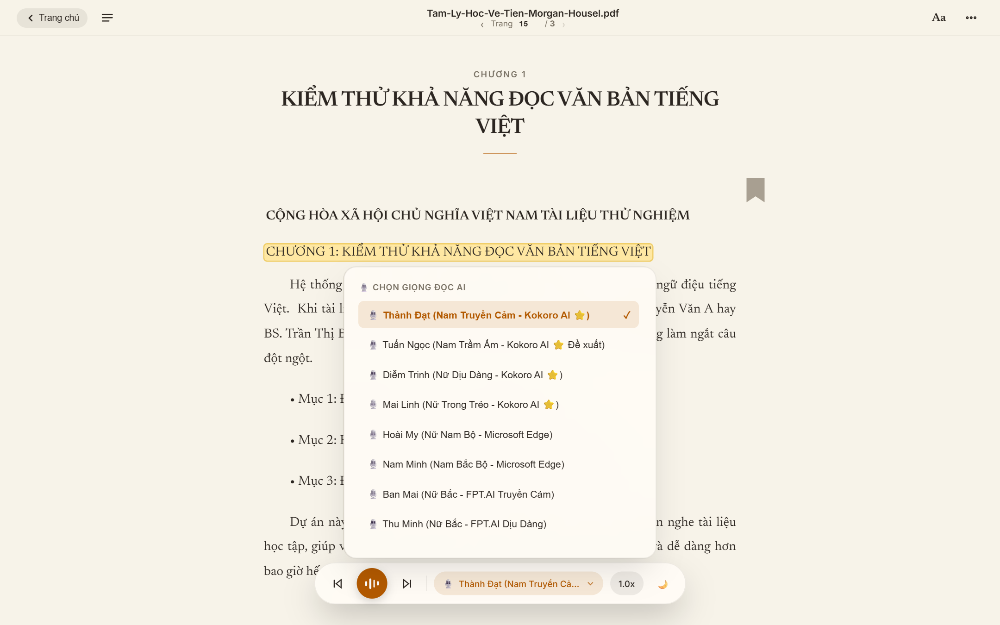
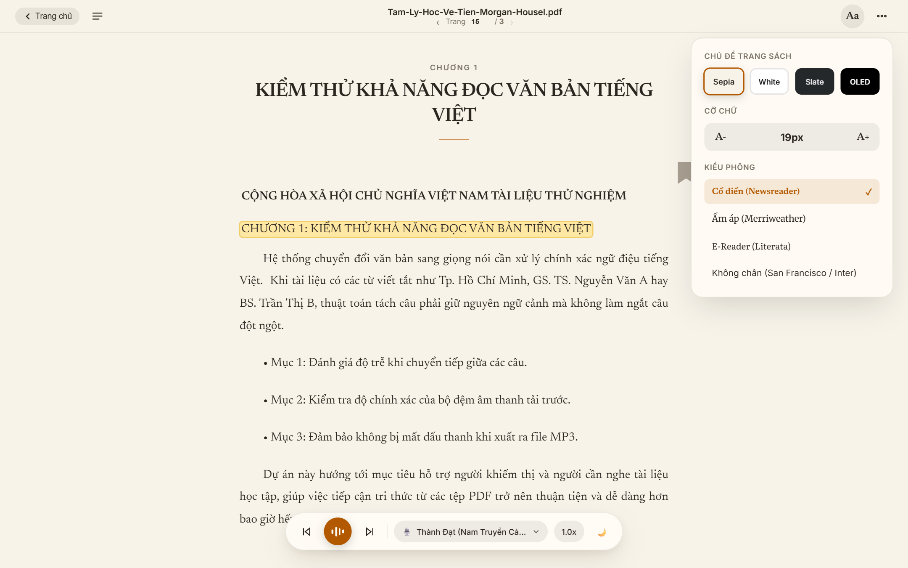
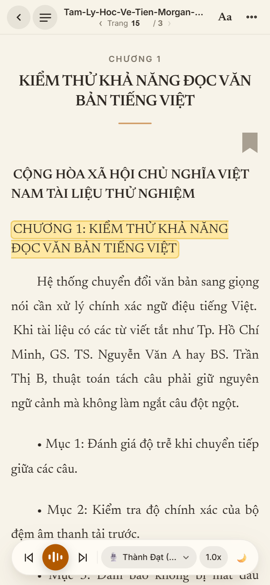
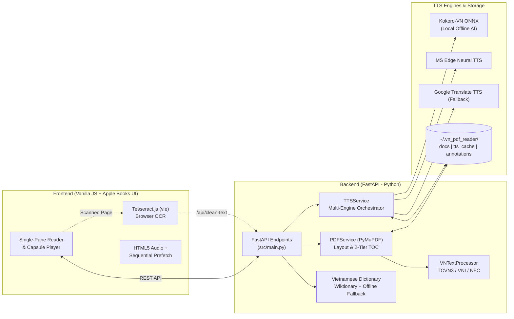

<div align="center">

# 📖 VN Multi-Format E-Reader & Natural AI TTS 🎧 (PDF • EPUB • TXT)

**Trình đọc sách điện tử Đa định dạng (PDF, EPUB, TXT) Tiếng Việt thông minh tích hợp sửa lỗi bảng mã cổ (TCVN3/VNI), OCR tự động và đa giọng đọc AI tự nhiên (Kokoro-Vietnamese Local AI, Microsoft Edge Neural).**

[](#)
[](https://www.python.org/)
[](https://fastapi.tiangolo.com/)
[](#)
[](#kiểm-thử-chất-lượng-testing)
[](#giấy-phép-license)

[Tính năng nổi bật](#-tính-năng-nổi-bật) •
[Hình ảnh giao diện](#-hình-ảnh-giao-diện-screenshots) •
[Kiến trúc hệ thống](#️-kiến-trúc-hệ-thống) •
[Cài đặt & Sử dụng](#-cài-đặt--khởi-chạy-nhanh) •
[Tài liệu API](#-tài-liệu-api-endpoints) •
[Phím tắt](#️-phím-tắt-bàn-phím)

</div>

---

## 🎯 Giới Thiệu (Overview)

Nhiều sách điện tử (ebook) và tài liệu PDF Tiếng Việt trên mạng (đặc biệt là các bản PDF đời cũ hoặc tài liệu scan) thường gặp các vấn đề nghiêm trọng khi đọc hoặc nghe bằng công cụ Text-to-Speech thông thường:
- **Lỗi bảng mã cổ:** Văn bản dùng font **TCVN3 (`.VnTime`)** hoặc **VNI-Windows** bị biến thành ký tự vô nghĩa khi copy hoặc đọc.
- **Lỗi ký tự & dấu tách rời:** Ký tự cổ `ƣ` (`\u01a3`) thay vì `ư`, dấu thanh bị rớt khỏi nguyên âm (combining diacritics), hoặc lỗi giải mã UTF-8 (Mojibake).
- **Ngắt dòng cứng giữa câu:** PDF ngắt dòng theo khổ giấy khiến giọng đọc AI bị khựng lại ở cuối mỗi dòng hoặc đọc lặp lại số trang/header/footer.
- **PDF scan ảnh / hỏng CMap:** Không thể trích xuất chữ trực tiếp.

**VN PDF Reader** giải quyết triệt để các vấn đề trên thông qua một đường ống xử lý văn bản Tiếng Việt chuyên sâu kết hợp giao diện đọc sách tối giản lấy cảm hứng từ **Apple Books / Kindle** và trình phát âm thanh AI mượt mà.

---

## 🖼️ Hình Ảnh Giao Diện (Screenshots)

### 1. Màn hình Trang chủ (Apple Books Minimalist Home)
Giao diện thư viện tinh gọn với khu vực kéo-thả PDF trung tâm và danh sách **"Đang đọc dở"** tự động lưu tiến độ trang sách và phần trăm hoàn thành:



### 2. Trình đọc sách tập trung 1 cột & Thanh điều khiển âm thanh nổi (Clean Reader & Floating Capsule)
Trình bày trang sách dạng **Single-Pane Clean Reader** chuẩn máy đọc sách chuyên dụng, tô sáng từng câu đang đọc (Whispersync Highlighter) và điều khiển phát qua **Floating Capsule Player** với nút Play biểu tượng sóng âm động:



### 3. Mục lục chuẩn trình duyệt PDF (Page Thumbnails & Document Outline Tree)
Thanh ngăn kéo bên trái tích hợp cột chuyển đổi **Icon Rail** giống trình xem PDF trên Chrome: xem lưới **Hình thu nhỏ từng trang (Page Thumbnails)** hoặc **Cây đề mục tài liệu phân cấp (Document Outline)** cùng quản lý **Dấu trang & Highlight**:



### 4. Đa giọng đọc AI Tiếng Việt & Tùy chỉnh tốc độ đọc linh hoạt
Hỗ trợ 4 giọng **Kokoro-Vietnamese AI chạy cục bộ (Offline)** với giọng mặc định **Thành Đạt**, kết hợp **Microsoft Edge Neural TTS** và thanh trượt tốc độ đọc tùy chỉnh (`0.5x – 2.5x`):



### 5. Tùy biến Typography (`Aa`) & 4 Chủ đề màu sắc E-Reader
Tùy chỉnh phông chữ xuất bản (*Literata, Merriweather, Inter, Georgia*), cỡ chữ, giãn dòng, độ rộng trang và 4 chế độ màu nền bảo vệ mắt (*Giấy ngà, Đêm sâu, Mực điện tử, Sáng dịu*):



### 6. Giao diện Responsive trên Thiết bị Di động (Mobile View)
Tối ưu hoàn chỉnh cho màn hình điện thoại di động với thanh Header tinh gọn và cụm điều khiển âm thanh thu gọn vừa khít màn hình:

<div align="center">
  
</div>

---

## ✨ Tính Năng Nổi Bật

### 🔤 1. Xử lý & Phục hồi Văn bản Tiếng Việt (`src/vn_text_processor.py`)
- **Tự động nhận diện & chuyển mã:** Phát hiện và chuyển đổi chính xác bảng mã **TCVN3 (ABC)** và **VNI-Windows** sang chuẩn **Unicode dựng sẵn (`NFC`)**.
- **Sửa lỗi ký tự & dấu thanh:** Khôi phục lỗi giải mã UTF-8 (Mojibake), ghép dấu thanh rời rạc và chuyển đổi ký tự `ƣ`/`Ƣ` sang `ư`/`Ư`.
- **Thuật toán nối dòng & tách đoạn thông minh:**
  - Phân tích tọa độ khối văn bản (`gap > 4.0pt`) để bảo toàn đoạn văn sách.
  - Lọc bỏ số trang và watermark ở mép trên/dưới (`4%` / `96%`) mà không cắt nhầm nội dung.
  - Tách câu Tiếng Việt chuẩn ngữ pháp, bảo vệ các từ viết tắt phổ biến (`TP.HCM`, `TS.`, `GS.`, `PGS.`) và số thứ tự đầu dòng (`1.`, `2.`).
- **Tích hợp OCR tự động (`Tesseract.js vie`):** Tự động nhận diện trang scan hoặc lỗi font nặng để quét OCR trực tiếp trên trình duyệt, kèm cơ chế chống ghi đè phiên OCR khi lật trang nhanh (`ocrSessionId`).

### 🎙️ 2. Hệ thống Đa Giọng Đọc AI (Multi-Engine TTS - `src/tts_service.py`)
- **Kokoro-Vietnamese Local AI (Chạy Offline trên máy):**
  - 4 giọng đọc tự nhiên: **Thành Đạt** *(Nam trầm ấm - Mặc định)*, **Tuấn Ngọc** *(Nam truyền cảm)*, **Diễm Trinh** *(Nữ miền Nam)*, **Mai Linh** *(Nữ miền Bắc)*.
- **Microsoft Edge Neural TTS:** Giọng **Hoài My (Nữ)** và **Nam Minh (Nam)** tốc độ cao, hỗ trợ cấu hình HTTP Proxy doanh nghiệp.
- **Google Translate TTS:** Tầng dự phòng cuối cùng đảm bảo không bao giờ gián đoạn việc đọc.
- **Tải trước tuần tự (Sequential Prefetching) & Bộ nhớ đệm (Disk Cache):** Lưu cache âm thanh tại `~/.vn_pdf_reader/tts_cache` và tách biệt tốc độ phát (`audio.playbackRate`) giúp đổi tốc độ tức thì không cần tải lại audio.

### 📚 3. Trải nghiệm Đọc sách Chuyên sâu (E-Reader Experience)
- **Mục lục kép (Dual-Mode TOC Sidebar):** Xem ảnh thu nhỏ trang PDF (`Page Thumbnails`) hoặc cây đề mục 2 tầng (Metadata Outline + Heuristic Regex Scanner nhận diện *Chương, Phần, Bài, Mục*).
- **Đánh dấu & Ghi chú (`Annotations`):** Lưu trữ bền vững Dấu trang (`🔖`) và tô màu Highlight 4 màu dạ quang theo từng cuốn sách.
- **Tra từ điển Tiếng Việt tức thì:** Bôi đen từ bất kỳ để tra nghĩa từ Wiktionary Tiếng Việt kèm kho từ điển nội bộ dự phòng khi offline.
- **Hẹn giờ tắt đọc sách (`Sleep Timer`):** Hẹn giờ 15/30/45 phút hoặc hết trang hiện tại, tự động đổi biểu tượng đồng hồ đếm ngược `⏳` và giảm dần âm lượng (fade-out) trước khi dừng.
- **Xuất sách nói MP3:** Tải trọn vẹn trang đang đọc thành file `.mp3` theo đúng giọng đọc và tốc độ đã chọn.

---

## 🏗️ Kiến Trúc Hệ Thống



---

## 📂 Cấu Trúc Thư Mục

```text
vn-pdf-reader/
├── src/
│   ├── main.py                  # FastAPI application & REST API endpoints
│   ├── pdf_service.py           # Trích xuất PDF (PyMuPDF), lọc header/footer, TOC 2 tầng, render ảnh
│   ├── vn_text_processor.py     # Chuyển mã TCVN3/VNI -> NFC, sửa dấu rời, nối dòng & tách câu
│   ├── tts_service.py           # Điều phối đa nguồn TTS (Kokoro Local, Edge-TTS, gTTS) & Cache
│   └── static/
│       ├── index.html           # Giao diện HTML5 (Home Screen, Reader View, Drawers & Modals)
│       ├── styles.css           # Hệ thống Design Token, 4 chủ đề E-Reader & Responsive Mobile
│       └── app.js               # Quản lý trạng thái đọc, Audio Player, OCR, TOC Thumbnails & Annotations
├── tests/
│   ├── unit/                    # Unit tests cho PDFService, TTSService, VNTextProcessor
│   ├── integration/             # Integration tests cho toàn bộ REST API endpoints
│   ├── e2e/                     # End-to-End pipeline tests (TCVN3, Scanned PDF, Multipage)
│   └── fixtures/                # Trình tạo file PDF giả lập phục vụ kiểm thử tự động
├── docs/
│   └── screenshots/             # Hình ảnh minh họa giao diện phần mềm
├── requirements.txt             # Danh sách thư viện Python phụ thuộc
├── pytest.ini                   # Cấu hình chạy kiểm thử Pytest
├── run.bat                      # Script khởi chạy nhanh trên Windows (tự mở trình duyệt)
├── run_silent.vbs               # Script khởi chạy ngầm không hiện cửa sổ dòng lệnh
└── CHANGELOG.md                 # Nhật ký thay đổi chi tiết qua từng phiên bản
```

---

## 🚀 Cài Đặt & Khởi Chạy Nhanh

### Yêu cầu hệ thống
- **Hệ điều hành:** Windows 10/11, macOS hoặc Linux.
- **Python:** Phiên bản `3.10` trở lên.

### Cách 1: Khởi chạy tức thì trên Windows (Khuyên dùng)
Chỉ cần nhấp đúp chuột vào file **`run.bat`** tại thư mục gốc của dự án:
```bat
run.bat
```
Script sẽ tự động kích hoạt môi trường ảo `.venv`, khởi chạy FastAPI server tại cổng `8788` và mở trình duyệt đến địa chỉ **`http://127.0.0.1:8788`**.

### Cách 2: Cài đặt và chạy thủ công từ Terminal

1. **Tạo và kích hoạt môi trường ảo Python:**
   ```powershell
   python -m venv .venv
   .\.venv\Scripts\activate
   ```

2. **Cài đặt các gói thư viện cần thiết:**
   ```powershell
   pip install -r requirements.txt
   ```

3. **Khởi chạy máy chủ Uvicorn:**
   ```powershell
   python -m uvicorn src.main:app --host 127.0.0.1 --port 8788 --reload
   ```

4. Mở trình duyệt và truy cập: **`http://127.0.0.1:8788`**

---

## 🔌 Tài Liệu API Endpoints

Khi máy chủ đang chạy, bạn có thể xem tài liệu Swagger UI trực tiếp tại `http://127.0.0.1:8788/docs`. Các endpoint chính bao gồm:

| Phương thức | Endpoint | Mô tả chức năng |
| :--- | :--- | :--- |
| `POST` | `/api/upload` | Tải lên file (PDF, EPUB, TXT), lưu cache cục bộ, trả về `doc_id`, `file_type`, tổng số trang và cây mục lục `toc`. |
| `GET` | `/api/doc/{doc_id}/page/{page_num}` | Trích xuất văn bản trang PDF, tự động sửa lỗi TCVN3/VNI, trả về danh sách câu & cảnh báo OCR. |
| `GET` | `/api/doc/{doc_id}/page/{page_num}/image` | Xuất ảnh PNG của trang PDF (`dpi=60` cho thumbnail, `dpi=150-240` cho xem chi tiết/OCR). |
| `GET` | `/api/doc/{doc_id}/toc` | Lấy danh sách mục lục 2 tầng (Metadata Outline hoặc Heuristic Regex). |
| `GET/POST` | `/api/doc/{doc_id}/annotations` | Đọc và lưu trữ Dấu trang (`bookmarks`) cùng ghi chú tô màu (`highlights`). |
| `POST` | `/api/clean-text` | Làm sạch và tách câu cho văn bản thô thu được từ trình quét OCR `Tesseract.js`. |
| `GET` | `/api/voices` | Danh sách toàn bộ giọng đọc khả dụng (Kokoro-VN, Edge-TTS, Google TTS). |
| `POST` | `/api/tts` | Tổng hợp âm thanh giọng đọc từ văn bản (trả về `audio/mpeg` hoặc `audio/wav` từ cache/engine). |
| `GET` | `/api/dictionary/lookup` | Tra cứu nghĩa từ Tiếng Việt (`?word=...`) từ Wiktionary & từ điển nội bộ. |
| `GET/POST` | `/api/config` | Xem và cập nhật cấu hình HTTP Proxy và hồ sơ phần cứng. |

---

## ⌨️ Phím Tắt Bàn Phím

| Phím tắt | Chức năng |
| :---: | :--- |
| `Space` | Phát / Tạm dừng giọng đọc AI (Play / Pause) |
| `←` / `→` | Lật sang Trang trước / Trang tiếp theo |
| `J` / `K` | Chuyển nhanh về Chương trước / Chương tiếp theo |
| `B` | Đánh dấu trang hiện tại (Toggle Bookmark Ribbon) |
| `F` | Bật / Tắt chế độ đọc tập trung toàn màn hình (Zen Focus Mode) |
| `?` | Mở bảng hướng dẫn phím tắt |
| `Esc` | Đóng các hộp thoại, Popover hoặc ngăn kéo Mục lục đang mở |
| **Click vào câu** | Nhảy tới và bắt đầu đọc ngay từ câu vừa chọn |
| **Bôi đen chữ** | Mở thanh công cụ nổi: Tô màu Highlight, Tra từ điển, Đọc từ đây, Sao chép |

---

## 🧪 Kiểm Thử Chất Lượng (Testing)

Dự án đi kèm bộ kiểm thử tự động gồm **68 test cases** bao phủ toàn bộ các tầng **Unit Test**, **Integration Test** và **End-to-End (E2E) Pipeline**:

```powershell
# Chạy toàn bộ 68 bài kiểm thử với Pytest
.\.venv\Scripts\python.exe -m pytest -v
```

- **`tests/unit/`**: Kiểm thử chuyển mã TCVN3/VNI, khôi phục dấu thanh rời, tách câu bảo toàn từ viết tắt, lọc header/footer PDF, mục lục 2 tầng và cơ chế cache TTS.
- **`tests/integration/`**: Kiểm thử toàn bộ REST API endpoints với FastAPI `TestClient`.
- **`tests/e2e/`**: Kiểm thử luồng đọc sách đầu-cuối với tài liệu PDF nhiều trang, PDF mã TCVN3 và PDF scan.

---

## 📝 Nhật Ký Thay Đổi (Changelog)

Xem chi tiết lịch sử phát triển và các bản cập nhật tại tệp [CHANGELOG.md](CHANGELOG.md).

---

## 📄 Giấy Phép (License)

Dự án được phân phối dưới giấy phép **MIT License** — tự do sử dụng, chỉnh sửa và đóng góp cho cộng đồng.
